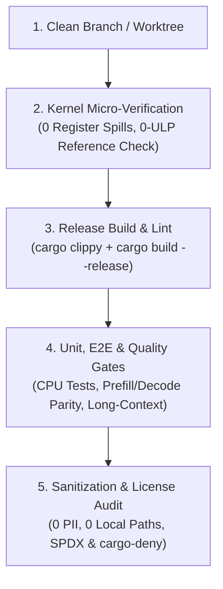

# Contributing to Flux Engine

> Flux Engine is an independently maintained Rust inference project developed from a fork of Atlas. We recognize the original Atlas authors and the wider open-source and research communities whose work contributed to its foundation. See [Credits](CREDITS.md), [Third-Party Notices](THIRD_PARTY_NOTICES.md), [Source and Licenses](SOURCE_AND_LICENSES.md), and [License](LICENSE) for project lineage, contributor recognition, and required notices.

---

## 1. Licensing & Contribution Terms

- **Inbound = Outbound (`AGPL-3.0-only`):** Flux Engine is licensed strictly under the **GNU Affero General Public License v3.0 only** ([`LICENSE`](LICENSE)). No separate Contributor License Agreement is required; contributions submitted via GitHub pull requests are accepted under standard GitHub Terms of Service (inbound = outbound under `AGPL-3.0-only`).
- **Developer Certificate of Origin (DCO):** Contributors are encouraged to sign off commits with `git commit -s` (`Signed-off-by: Name <email>`) to certify that they have the right to submit their work under the project's license.
- **SPDX Headers & Third-Party Notices:**
  - Every new first-party Rust, CUDA, C/C++, or Metal source file must start with `// SPDX-License-Identifier: AGPL-3.0-only` (checked in CI via `.licenserc.yaml`).
  - Any adapted or vendored permissive third-party code (`MIT`, `Apache-2.0`, `BSD-3-Clause`, `ISC`) must retain all upstream copyright and license headers and be documented in [`THIRD_PARTY_NOTICES.md`](THIRD_PARTY_NOTICES.md) and [`SOURCE_AND_LICENSES.md`](SOURCE_AND_LICENSES.md).

---

## 2. Engineering Workflow

Every kernel or runtime change in `TheApathy/flux-engine` goes through five verification steps before merge:



---

## 3. GB10 Unified Memory Safety Rules

1. **Check `MemAvailable` Before Compiling or Serving on GB10:**
   - Because Grace CPU and Blackwell GPU share 128 GB of LPDDR5X unified memory without a separate PCIe VRAM bar, running a multi-target Rust/CUDA build while a 70 GB model is resident in memory can drop free memory below the `6,144 MiB` hardware watchdog floor.
   - Always check `/proc/meminfo` (`awk '/MemAvailable/ {printf "%.1f GiB\n", $2/1048576}' /proc/meminfo`) before launching a server or compilation job.
2. **Compile `-p spark-server` with Explicit Target Filters:**
   - Build only the model targets you are testing:
     ```bash
     export PATH="/usr/local/cuda/bin:${PATH}"
     FLUX_TARGET_HW=gb10 \
     FLUX_TARGET_MODEL="qwen3.8-flash-next,qwen3.8-27b" \
     FLUX_TARGET_QUANT=nvfp4 \
       cargo build --release -p spark-server
     ```
3. **Optional Local Linker / Host CPU Flags:**
   - The checked-in `.cargo/config.toml` keeps builds portable across Linux and macOS hosts. For faster local Linux builds, you may opt in via environment variables such as `RUSTFLAGS="-C target-cpu=native -C link-arg=-fuse-ld=mold"` in your local shell.

---

## 4. Code & Kernel Standards

### 4.1 Rust Workspace Standards (`edition = "2024"`, toolchain pinned in `rust-toolchain.toml`)
- **Toolchain Compatibility:** `rust-toolchain.toml` pins the reproducible workspace toolchain (`1.93.1`; `rustc 1.88+` is required for `libloading 0.9`).
- **Zero Warnings Policy:** CI enforces zero compiler and Clippy warnings across workspace targets (`cargo clippy --workspace --all-targets -- -D warnings`) and standard formatting (`cargo fmt --all -- --check`).
- **No Unbounded Host Clones in Hot Paths:** Avoid per-request vocabulary clones, large `Vec` allocations, or `munmap` churn on the prefill/decode critical path (use `Arc` zero-copy handles or pre-allocated scratch arenas).
- **Runtime Selector Receipts:** Any new optimization path gated by an `ATLAS_*` / `FLUX_*` environment selector should emit a structured engagement receipt (`*_ENGAGED`) once per server lifetime so benchmark harnesses can verify active dispatch.

### 4.2 CUDA / PTX Kernel Standards (`sm_121a` / `sm_120`)
- **Zero Register Spills:** All kernels in `kernels/gb10/` should compile under `nvcc -arch=sm_121a --cubin -Xptxas -v -fmad=false` with `0 bytes stack frame, 0 bytes spill stores, 0 bytes spill loads`.
- **PTX Identity Preservation:** Never alter the PTX output of pinned reference kernels when adding a new fast path. Introduce a dedicated kernel entry point (e.g., `*_pipe`, `*_v2`, `*_v3_commit`) and route via selector dispatch.
- **Bit-Exactness (`0 ULP`):** Fused kernels must match reference outputs to `0 ULP` (or explicitly document bounded FP8 numerical behavior verified by `10/10` greedy token parity and `5/5` Estonia long-context accuracy).

---

## 5. Pre-Submission Checklist

- [ ] **Clean Build, Clippy & Formatting:**
  ```bash
  cargo fmt --all -- --check
  ATLAS_TARGET_HW=gb10 cargo clippy --workspace --all-targets -- -D warnings
  ATLAS_TARGET_HW=rtx6000 cargo check --workspace --all-targets
  ```
- [ ] **CPU Unit & Harness Tests:**
  ```bash
  cargo test --workspace --lib
  pytest repro-kit/tests
  ```
- [ ] **Prefill & Lossless Decode Verification (when modifying GPU kernels/runtime):**
  - `Qwen3.8-Flash-Next`: `8K..128K` prefill deterministic (`20/20` identical hashes), `LOSSLESS 10/10` (`2,560 / 2,560` greedy tokens match `--no-speculative`), `5/5 PASS` on 136.5K Estonia (`bench/qwen38-flash-next-gb10/estonia_bench.py`), and `MemAvailable >= 6,656 MiB` (`0` watchdog kills).
  - `Qwen3.8-27B`: 400-token MinHeap probe (`bench/qwen38-gb10/weschera_minheap_repro.py`) deterministic across repeated runs.
- [ ] **Zero-Leak & Path Sanitization:** No machine-local user directory paths, internal hostnames, private IPs, or credentials in any tracked file.
- [ ] **License & Attribution Integrity:** `AGPL-3.0-only` SPDX headers, `deny.toml` compliance, and upstream attributions in [`CREDITS.md`](CREDITS.md), [`THIRD_PARTY_NOTICES.md`](THIRD_PARTY_NOTICES.md), and [`SOURCE_AND_LICENSES.md`](SOURCE_AND_LICENSES.md) remain intact.
