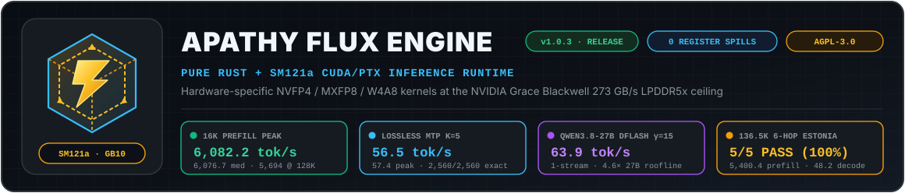
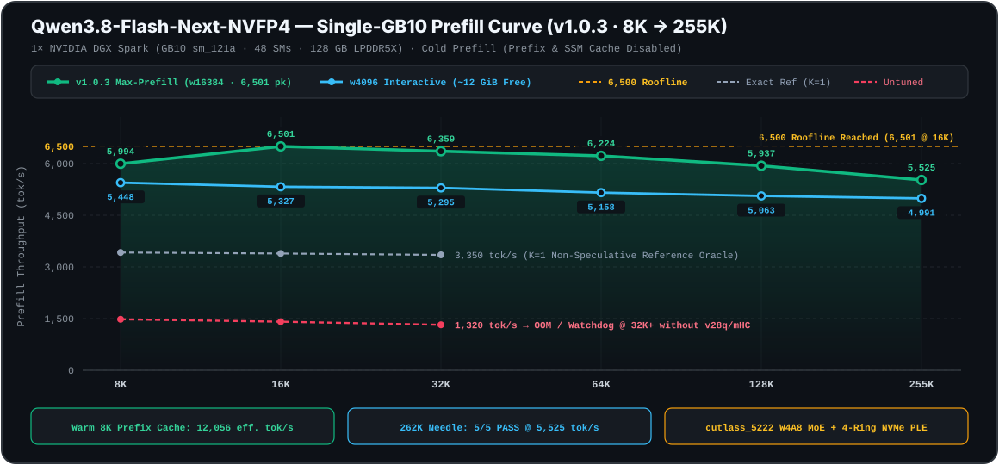
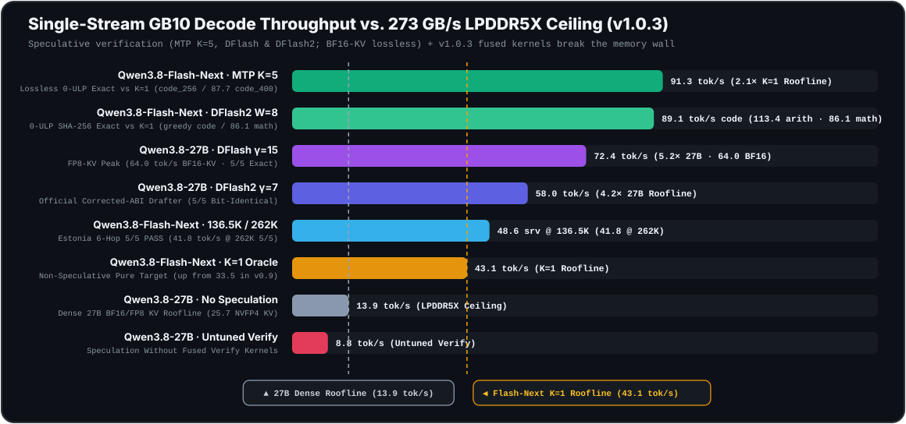
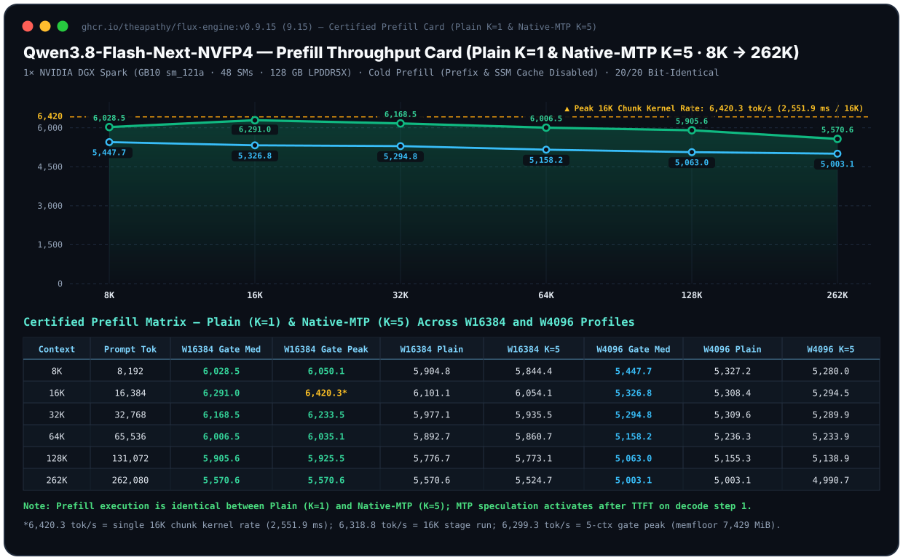
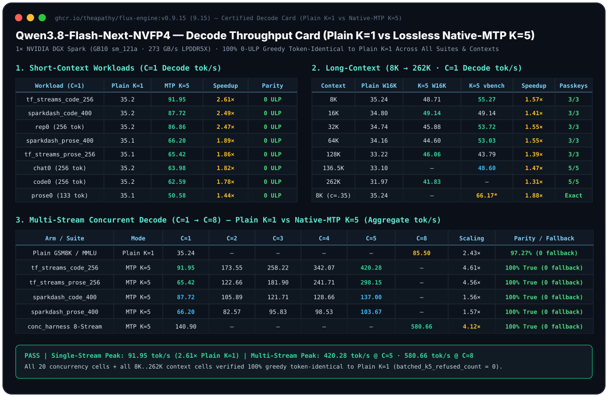
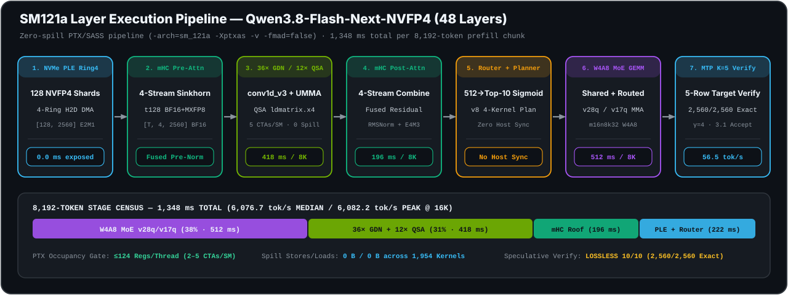
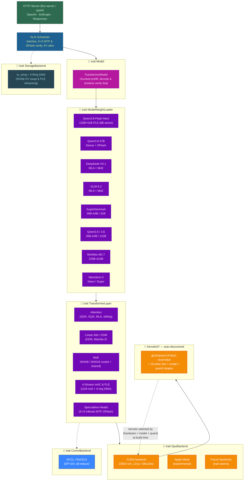
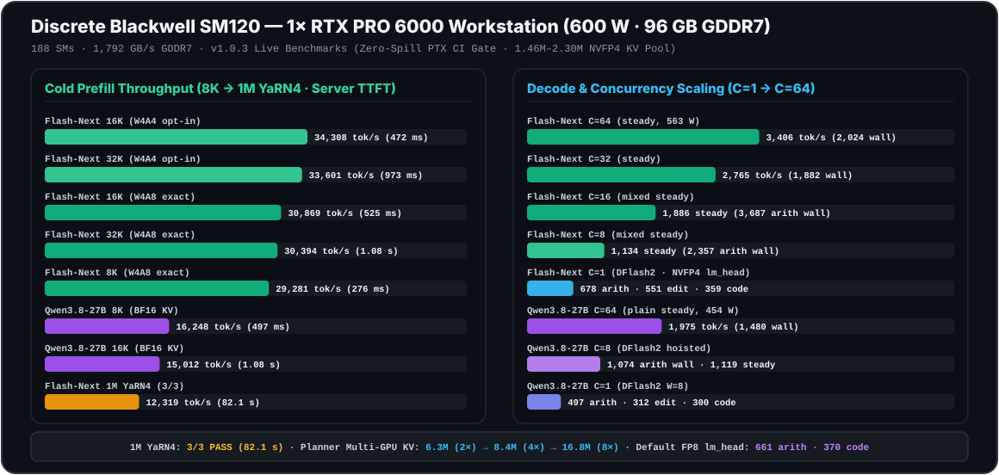

<p align="center">
  
</p>

<h1 align="center">Flux Inference Engine</h1>

<p align="center">
  <strong>Self-contained Rust + custom Blackwell CUDA/PTX LLM inference server.</strong><br>
  Zero Python runtime dependency · OpenAI, Anthropic &amp; Ollama-compatible API · Formally verified invariants
</p>

<p align="center">
  <a href="https://theapathy.github.io/flux-engine/"></a>
  <a href="https://github.com/TheApathy/flux-engine/actions/workflows/ci.yml"></a>
  <a href="https://github.com/TheApathy/flux-engine/actions/workflows/formal-verify.yml"></a>
  <a href="https://github.com/TheApathy/flux-engine/actions/workflows/release.yml"></a>
  <a href="https://scorecard.dev/viewer/?uri=github.com/TheApathy/flux-engine"></a>
  <a href="LICENSE"></a>
</p>

---

## Overview

**Flux Engine** (`v1.0.3`, `AGPL-3.0-only`) is an independently maintained Rust + CUDA/PTX LLM inference engine built on [`MonumentalSystems/atlas`](https://github.com/MonumentalSystems/atlas) and [`Avarok-Cybersecurity/atlas`](https://github.com/Avarok-Cybersecurity/atlas) via [`TheApathy/apathy-atlas`](https://github.com/TheApathy/apathy-atlas).

- **Native Rust + Blackwell CUDA/PTX:** Zero Python runtime dependency. Compiles target-specific kernels with static dispatch for **GB10 (`sm_121a`, 128 GB UMA)**, discrete **SM120** (RTX 50-series / RTX PRO 5000 & 6000), **SM103**, and experimental Apple Silicon **Metal**.
- **Drop-In Serving & Operations:** OpenAI (`/v1/chat/completions`, `/v1/responses`), Anthropic (`/v1/messages`), and Ollama endpoints with SSE streaming, continuous batching, lossless speculative decoding (`MTP` / `DFlash2`), radix prefix caching, structured JSON/EBNF output (`xgrammar`), Prometheus `/metrics`, Ratatui TUI, and Web UI.
- **Multi-Model Coverage:** `Qwen3.8-Flash-Next`, `Qwen3.8-27B`, `DeepSeek-V4.1`, `GLM-5.3-Flash`, `Gemma-4`, `Qwen3.6-35B-A3B`, `Qwen3.5`, `Mistral-Small-4`, `MiniMax-M2.7`, and `Nemotron-3` ([`docs/compatibility/model-matrix.yaml`](docs/compatibility/model-matrix.yaml)).
- **Formally Verified & Signed Supply Chain:** 19 Z3 SMT UNSAT theorems, a 99,596-state TLA+ BFS scheduler model, a zero-spill PTX/SASS CI gate, SSH-signed commits/tags, SLSA Build L3 provenance, Cosign + Rekor signatures, and SPDX 2.3 SBOMs ([`SIGNING.md`](SIGNING.md)).

## Documentation & Navigation

| Area | Links |
|---|---|
| **Docs & API** | [Documentation Site](https://theapathy.github.io/flux-engine/) · [OpenAPI Explorer](https://theapathy.github.io/flux-engine/api-explorer/) · [`GETTING_STARTED.md`](docs/GETTING_STARTED.md) · [`FLAGS.md`](docs/FLAGS.md) · [`docs/API.md`](docs/API.md) |
| **Serve & Deploy** | [Quick Start](#serve-it-now) · [Build from Source](#or-build-from-source) · [`deploy/` (systemd, K8s, Grafana)](deploy/README.md) · [`docs/clients/` (Claude Code, Codex, OpenCode)](docs/clients/README.md) |
| **Benchmarks & Specs** | [Profile Tables](#why-the-defaults-are-baked-in) · [`repro-kit/`](repro-kit/README.md) · [`BENCHMARK_VERIFICATION.md`](docs/verification/BENCHMARK_VERIFICATION.md) · [`ARCHITECTURE.md`](docs/ARCHITECTURE.md) · [`docs/KERNEL-PROFILE.md`](docs/KERNEL-PROFILE.md) |
| **Engineering & Security** | [`AGENTS.md`](AGENTS.md) · [`CONTRIBUTING.md`](CONTRIBUTING.md) · [`SIGNING.md`](SIGNING.md) · [`.github/SECURITY.md`](.github/SECURITY.md) · [`CHANGELOG.md`](CHANGELOG.md) · [`CREDITS.md`](CREDITS.md) |

## Qualified Performance (`v1.0.3` — `GB10` & Discrete `SM120`)

| Hardware / Model | Measured Result | Verification |
|---|---|---|
| **GB10 (`sm_121a`) · `Qwen3.8-Flash-Next-NVFP4`** (`125B + 51B` PLE, `6B` active) — Prefill | **6,501 tok/s** (`16K` peak) · **6,359** (`32K`) · **5,937** (`128K`) · **5,525** (`255K`) · **12,056** warm 8K cache | `w16384` default; interactive `w4096` delivers **4,991–5,448 tok/s** (`~12 GiB` free UMA) |
| **GB10 (`sm_121a`) · `Qwen3.8-Flash-Next-NVFP4`** — Lossless Speculative Decode | **91.3 tok/s** (`K=5` MTP code) · **89.1** (`DFlash2 W=8` greedy code, **86.1** math) · **43.1** (`K=1` oracle) · **580.7** (`C=8` `K=5`) | `0` token divergence vs `K=1`; **97.27%** GSM8K (`1,283/1,319`); **5/5 PASS** `262K` & `136.6K` 6-hop needle |
| **GB10 (`sm_121a`) · `Qwen3.8-27B-NVFP4`** (dense hybrid + `DFlash` / `DFlash2`) | **72.4 tok/s** (`DFlash γ=15`, `FP8` KV) · **64.0 tok/s** (`BF16` KV) · **58.0 tok/s** (`DFlash2 γ=7`) · **172.6 tok/s** (`C=8` hoisted) | Prefill **1,773 tok/s** (`2K`) / **1,395 tok/s** (`8K`); `5/5` bit-identical verification |
| **SM120 (`1× RTX PRO 6000 WS`, `600 W`) · `Qwen3.8-Flash-Next-NVFP4`** | **30,869 tok/s** `16K` W4A8 (**34,308** W4A4) · **678 tok/s** `C=1` `DFlash2` · **3,406 tok/s** `C=64` steady (**3,687** `C=16` arith) | **`1M` YaRN4: 3/3 PASS** (`1,011,019` tok in `82.1 s`, `12,319 tok/s`); `1.46M–2.30M` resident KV pool |
| **SM120 (`1× RTX PRO 6000 WS`, `600 W`) · `Qwen3.8-27B-NVFP4`** | **16,248 tok/s** `8K` prefill · **438.4 tok/s** `C=1` `DFlash2` · **1,073.8 tok/s** `C=8` wall · **1,974.8 tok/s** `C=64` plain | `C=64` hits **`97.3%`** of `1,792 GB/s` GDDR7 roofline · [full profile tables](#why-the-defaults-are-baked-in) |

<a id="serve-it-now"></a>

## Quick Start (Serve It Now)

### 1. Run with Docker (GHCR)

Mount your local models directory at `/models` — the entrypoint auto-detects the checkpoint architecture, quantization config, PLE shards, vision towers, and companion `DFlash2`/`MTP` drafters. Official signed multi-arch images (`:v1.0.3` / `:latest`) resolve automatically to **GB10 (`linux/arm64`, `:v1.0.3-gb10`)** and **SM120 (`linux/amd64`, `:v1.0.3-sm120`)**, with statically compiled FlashInfer FA2 prefill and tuned deterministic recipes built in.

```bash
# NVIDIA GB10 / DGX Spark (linux/arm64) — auto-detects model & recipe under /models
docker run --rm --gpus all --ipc=host \
  --ulimit memlock=-1 --ulimit stack=67108864 \
  -p 127.0.0.1:8899:8899 \
  -v "$MODELS_ROOT:/models:ro" \
  ghcr.io/theapathy/flux-engine:v1.0.3-gb10

# Discrete Blackwell SM120 (RTX 5090 / RTX PRO 6000, linux/amd64)
docker run --rm --gpus all --ipc=host \
  --ulimit memlock=-1 --ulimit stack=67108864 \
  -p 127.0.0.1:8899:8899 \
  -v "$MODELS_ROOT:/models:ro" \
  ghcr.io/theapathy/flux-engine:v1.0.3-sm120
```

Verify the running server:

```bash
curl -sf http://127.0.0.1:8899/health
curl -sf http://127.0.0.1:8899/v1/models
```

<details>
<summary><b>More Docker examples</b> (high concurrency, selecting a checkpoint, <code>list-models</code>, optional <code>io_uring</code>)</summary>

```bash
# High-concurrency C=16 serving (auto-attaches companion DFlash2 if present under /models)
docker run --rm --gpus all --ipc=host \
  --ulimit memlock=-1 --ulimit stack=67108864 \
  -p 127.0.0.1:8899:8899 \
  -v "$MODELS_ROOT:/models:ro" \
  -e FLUX_CONCURRENCY=16 \
  ghcr.io/theapathy/flux-engine:v1.0.3-gb10

# Serve a specific checkpoint with an explicit companion drafter
docker run --rm --gpus all --ipc=host \
  --ulimit memlock=-1 \
  -p 127.0.0.1:8899:8899 \
  -v "$MODELS_ROOT:/models:ro" \
  -e FLUX_MODEL=/models/Qwen3.8-27B-NVFP4 \
  -e FLUX_DRAFT_MODEL=/models/Qwen3.8-27B-DFlash2 \
  -e FLUX_MODE=auto \
  ghcr.io/theapathy/flux-engine:gb10

# Scan all local checkpoints under /models without launching a server
docker run --rm --gpus all -v "$MODELS_ROOT:/models:ro" \
  ghcr.io/theapathy/flux-engine:gb10 list-models /models
```

> **Optional `io_uring` for NVMe PLE offload:** Docker's default seccomp profile works out of the box (`ple_offload.rs` falls back to `pread64`). To enable kernel `io_uring` async DMA for `Qwen3.8-Flash-Next` NVMe PLE shards, pass `--security-opt seccomp=unconfined` or a custom seccomp profile allowing `io_uring_setup` / `io_uring_enter`.

</details>

<details>
<summary><b>Container environment variables</b> (<code>FLUX_*</code> reference — 15 options)</summary>

| Environment Variable | Default | Purpose |
|---|---|---|
| `FLUX_MODEL` | *(auto-discovered in `/models`)* | Path to local model checkpoint directory inside the container |
| `FLUX_MODE` | `auto` | Operating profile: `auto`, `max-prefill` (`w16384`), `interactive` (`w4096`), `fast-prefill` (`fast`), `decode` (`lossless-decode`), `long-context` (`136k`), `exact` (`exact-reference`) |
| `FLUX_PORT` | `8899` | HTTP listening port (`/v1/chat/completions`, `/v1/messages`, `/v1/models`, `/health`) |
| `FLUX_MAX_SEQ_LEN` | Mode-dependent (`40960`–`143360`) | Maximum context length in tokens (`--max-seq-len`) |
| `FLUX_KV_CACHE_DTYPE` | `auto` (`bf16` / `fp8` / `turboquant`) | KV cache precision (`bf16` required for lossless speculative decode recipes) |
| `FLUX_GPU_MEMORY_UTILIZATION` | `0.55` (GB10) / `0.90` (discrete) | Safe GPU/UMA memory fraction (`--gpu-memory-utilization`) |
| `FLUX_DRAFT_MODEL` | *(optional; built-in `mtp.*` used by default)* | Path to companion `DFlash` or external `MTP` drafter directory |
| `FLUX_GAMMA` | `auto` (`4` for MTP `K=5`, `block_size - 1` for DFlash) | Speculative draft tokens per step (`gamma`) |
| `FLUX_DFLASH_LOOKUP` | `off` | Opt-in lossless context-lookup drafting on top of DFlash (27B): `sam` or `retrieval` |
| `FLUX_DISABLE_SPECULATION` | `0` *(unset)* | Set to `1` to disable all speculative decoding (`FLUX_DRAFT_MODEL=none` disables external sidecars) |
| `FLUX_THINKING` | unset (`MODEL.toml` default) | Default `<think>` reasoning traces (`on`, `off`, or unset) |
| `FLUX_THINKING_BUDGET` | `MODEL.toml` profile (`262144`) | Optional server-ceiling override for reasoning tokens |
| `FLUX_CPU_AFFINITY` | `5-9,15-19` (GB10 ARM64) | CPU core pinning mask passed to `taskset -c` |
| `FLUX_PLE_RAM_STAGE` | `0` *(opt-in)* | Stage `ple-offload/` shards into `/dev/shm` `tmpfs` (`--shm-size=32g` required) |
| `FLUX_PLE_RAM_DIR` | `/dev/shm/flux-ple-offload` | Base `tmpfs` directory for `--ple-ram` / `FLUX_PLE_RAM_STAGE=1` |

See [`FLAGS.md`](docs/FLAGS.md), [`docs/CONTAINER_GUIDE.md`](docs/CONTAINER_GUIDE.md), and [`docs/OPERATOR-GUIDE.md`](docs/OPERATOR-GUIDE.md) for the complete CLI and environment reference.

</details>

### 2. Verify Throughput & Determinism

```bash
git clone https://github.com/TheApathy/flux-engine.git
python3 flux-engine/bench/qwen38-flash-next-gb10/lil_decode_bench.py \
  --endpoint http://127.0.0.1:8899/v1/chat/completions \
  --output /tmp/flash_next_probe.json --repetitions 3 --max-tokens 256
```

On a single GB10 (`sm_121a`), single-stream `K=5` decode reaches **62.6–91.3 tok/s** on code/repetition prompts, **50.6–66.2 tok/s** on prose/chat, **53.0–55.3 tok/s** at `8K–64K`, **46.1 tok/s** at `128K`, and **41.8 tok/s** at `255K–262K` — with `deterministic: true` (`3×256` bit-identical raw logits) and identical `stable_output_sha256` across repetitions. For the full `8K–128K` prefill and lossless `K=5` sweep:

```bash
docker run --rm --gpus all --ipc=host \
  --ulimit memlock=-1 \
  -v "$PWD/results:/results" \
  -v "$MODELS_ROOT:/models:ro" \
  ghcr.io/theapathy/flux-engine:v1.0.3-gb10 \
  bench run \
    --config /opt/flux/repro-kit/benchmark-config.yaml \
    --output /results/results.json
```

<a id="why-the-defaults-are-baked-in"></a>

### Why the defaults are baked in

The tuned `FLUX_*` / `ATLAS_*` profile variables in [`recipes/`](recipes/) are
load-bearing. Measured on the same single GB10 (`sm_121a`) across operating
profiles (`v1.0.x` / `v0.9.15` vs `v0.9.12-6k-stable` baseline):

> **Which mode to run:** `FLUX_MODE=auto` (default) selects `flux-nextgen-max-prefill-decode.env` (`262,144`-token capacity with `w16384` chunking; the legacy `v9` `flux-v9-max-prefill.env` defaults to `135,168`-token context). Select `--mode 256k` when you explicitly want the native-`262K` **BF16 QSA correctness profile** (BF16 QSA Q/K/V prefill operands, QSA verify rows `0`): it costs **~5% prefill** against FP8 QSA at `16K`–`128K` and ~`15%` at `8K` (measured A/B on GB10), and the launcher logs one `INFO` line when it engages.

| Operating Profile (`--mode` / Recipe) | 8K Prefill | 16K Prefill | 32K / 64K Prefill | 128K / 255K Prefill | Decode (`tok/s`) | Free UMA Floor |
|---|---:|---:|---:|---:|---:|---:|
| **`v1.0.3` (`flux-nextgen-max-prefill-decode.env`, `w16384` default)** | **5,994** (`12,056` warm cache) | **6,501** *(roofline reached)* | **6,359** @ 32K / **6,224** @ 64K | **5,937** @ 128K / **5,525** @ 255K | **91.26** (`K=5` `code_256`) · **87.72** (`code_400`) · **89.07** (`DFlash2 W=8` code, **86.08** math) · **66.20** (`prose_400`) · **53.03** @ 64K · **46.1** @ 128K · **41.8** @ 262K (`0-ULP` exact) | `>= 7,429 MiB` |
| **`v9-w4096` (`flux-v9-w4096-interactive.env`, `w4096`)** | **5,448** (`5,450` pk) | **5,327** (`5,341` pk) | **5,295** @ 32K / **5,158** @ 64K | **5,063** @ 128K / **4,991** @ 255K | **91.26** (`tf_code`) · **87.72** (`sd_code`) · **63.98** (`chat0`) · **62.59** (`code0`, `8/8 id=OK`) | **`>= 9,890 MiB`** |
| **Native Concurrency (`C=2..8` batched `K=5`, `C=1..16` `DFlash2`)** | — | — | — | — | `C=2..5`: **173.6 / 258.2 / 340.5 / 420.3** (`code`) · **121.9 / 181.9 / 241.7 / 295.7** (`prose`) · `C=8`: **580.7** (`K=5`) · `DFlash2 C=16`: **234.5** | `>= 9,500 MiB` |
| **Native `262K` (`--mode 256k`, `262,144` tokens; BF16 correctness profile)** | — | — | — | **5,525** (`5/5` needles `1%..99%`) | **41.8** @ 255K/262K · **46.1** @ 128K (`100%` parity) | **`>= 11,452 MiB`** |
| **`v0.9.12-6k-stable` (historical baseline, `w16384`)** | 5,830.2 | 6,082.2 | 5,969.6 @ 32K / 5,828.3 @ 64K | 5,694.4 @ 128K | 56.5 (`57.4` peak) | `7,072 – 8,450 MiB` |
| **`estonia-136k` (`flux-estonia-136k.env`, `136,576` tok)** | — | — | — | **5,400.4** (`25.29 s` TTFT) | **48.2** client (`48.6` srv, `5/5 PASS`) | **8,412 – 8,431 MiB** |
| **`exact-reference` (`flux-exact-reference.env`, `K=1` oracle)** | 3,420 | 3,390 | 3,350 | — | **43.06** @ `C=1` *(up from 33.5)* · **85.5** @ `C=8` native batched QSA | `8,800+ MiB` |
| **Untuned baseline (no `v28q`/`v17q`, no `qkpv_pipe`, no `mHC` roof)** | ~1,480 | ~1,410 | ~1,320 | OOM / watchdog | ~18.4 | `< 6,144 MiB` |

<p align="center">
  
</p>

And on **`Qwen3.8-27B-NVFP4`** (`bench/qwen38-gb10/`, GB10 `sm_121a` — prefill `1,773 tok/s` @ `2K`, `1,395 tok/s` @ `8K`):

| Configuration | Decode (`tok/s`) |
|---|---:|
| **`DFlash γ=15` (`FP8-KV` peak)** | **72.4** |
| **Qualified `DFlash γ=15` (`BF16-KV`, `5/5` bit-identical)** | **64.0** |
| **Official `z-lab/Qwen3.8-27B-DFlash2` (`--dflash-gamma 7`, `W=8`)** | **58.0** *(up from 43.9)* |
| **Hoisted Batched `DFlash2` (`C=2 / C=4 / C=8`)** | **76.2 / 79.3 / 172.6** |
| No speculation, tuned kernels (`BF16/FP8 KV` / `NVFP4 KV`) | **13.9** / **25.7** |
| Speculation on, **no tuning at all** | 8.8 |

<p align="center">
  
</p>

Every `FLUX_*` and `ATLAS_*` flag is documented in [`FLAGS.md`](docs/FLAGS.md),
[`bench/qwen38-flash-next-gb10/FLAGS.md`](bench/qwen38-flash-next-gb10/FLAGS.md),
and [`bench/qwen38-gb10/FLAGS.md`](bench/qwen38-gb10/FLAGS.md). To switch recipes
on the host, source [`scripts/flux_env_bridge.sh`](scripts/flux_env_bridge.sh)
(`source scripts/flux_env_bridge.sh --mode interactive-w4096`) or use the
self-verifying wrappers in [`bench/qwen38-flash-next-gb10/`](bench/qwen38-flash-next-gb10/).

### Checkpoint verification

Verify your local model directory against the 548-file SHA-256 manifest before serving:

```bash
./repro-kit/flux-bench verify-manifest --models-dir "$MODELS_ROOT"
```

## Or build from source

Produces the same throughput from a clean checkout:

```bash
git clone https://github.com/TheApathy/flux-engine.git
cd flux-engine

# nvcc must be ON PATH: cudarc's build script shells out to a bare
# `nvcc --version` and does NOT consult CUDA_HOME. A clean checkout has no
# cached build-script output, so this fails there even though it succeeds on a
# tree that has built before.
export PATH=/usr/local/cuda/bin:$PATH

# Build both Qwen3.8-Flash-Next and Qwen3.8-27B NVFP4 targets into flux-server:
FLUX_TARGET_MODEL='qwen3.8-flash-next,qwen3.8-27b' FLUX_TARGET_QUANT=nvfp4 \
  cargo build --release -p spark-server
```

Check the build log line, without `FLUX_TARGET_MODEL` (or `ATLAS_TARGET_MODEL`)
and `FLUX_TARGET_QUANT`, the build targets the default fallback and produces a
binary that will refuse `--kernel-target qwen3.8-flash-next`:

```text
atlas-kernels: compiled N kernels for target 0 (gb10, qwen3.8-flash-next, nvfp4)
```

Then serve with the self-verifying launcher (uses the checkpoint's built-in `mtp.*` head directly; or set `MTP_DIR=/path/to/external-mtp` to override):

```bash
MODEL_DIR=/path/to/Qwen3.8-Flash-Next-NVFP4-QAD5500-Hybrid \
  ./bench/qwen38-flash-next-gb10/serve.sh
```

## Test it

Run either the bundled standalone probes or the turnkey [**`local-inference-lab/llm-inference-bench`**](https://github.com/local-inference-lab/llm-inference-bench) (`v0.7.9`) suite via [`bench/llm-inference-bench/run-lil-bench.sh`](bench/llm-inference-bench/run-lil-bench.sh):

```bash
# 1. Turnkey local-inference-lab/llm-inference-bench profiles (auto-clones LIL if needed)
./bench/llm-inference-bench/run-lil-bench.sh matrix      # 0..128K context + sustained decode matrix
./bench/llm-inference-bench/run-lil-bench.sh prefill     # Standalone cold-prefill sweep (8K..128K)
./bench/llm-inference-bench/run-lil-bench.sh estonia     # 136,576-token 6-hop Estonia needle benchmark
./bench/llm-inference-bench/run-lil-bench.sh coding      # Burst C=1 decode throughput probe
./bench/llm-inference-bench/run-lil-bench.sh gsm8k       # Full 1,319-item GSM8K accuracy benchmark
./bench/llm-inference-bench/run-lil-bench.sh mmlu-pro    # Stratified 1,000-item MMLU-Pro accuracy benchmark
./bench/llm-inference-bench/run-lil-bench.sh gpqa        # 198-item GPQA Diamond accuracy benchmark

# 2. Bundled zero-dependency K=5 lossless decode & 136.5K Estonia verifiers
python3 bench/qwen38-flash-next-gb10/lil_decode_bench.py \
  --endpoint http://127.0.0.1:8899/v1/chat/completions \
  --output /tmp/flash_next_probe.json --repetitions 3 --max-tokens 256

python3 bench/qwen38-flash-next-gb10/estonia_bench.py \
  --endpoint http://127.0.0.1:8899/v1/chat/completions \
  --output /tmp/estonia_136k.json --repetitions 5
```

Measured the same way across all three execution paths on GB10 (`sm_121a`, historical `v0.9.12-6k-stable` container-vs-source-vs-host parity receipt — `<= 0.12%` variance across build paths):

| Path | 16K Prefill (`tok/s`) | `K=5` Decode (`tok/s`) | 136.5K Estonia |
|---|---:|---:|---:|
| Published container (`ghcr.io/theapathy/flux-engine:gb10`) | 6,076.7 | 56.5 | 5/5 PASS (`5,400.4` prefill / `48.2` decode) |
| Clean checkout, cold build from source | 6,074.8 | 56.5 | 5/5 PASS (`5,400.4` prefill / `48.2` decode) |
| Host, prebuilt pinned binary | 6,082.2 | 56.5 | 5/5 PASS (`5,400.4` prefill / `48.2` decode) |

All three produce byte-identical greedy token sequences (`dbba921ce205` at 8K,
`0695b563acde` at 16K/64K, `e47125968b3b` at 32K, `c51cdffb6e38` at 128K) and
match `K=1` non-speculative greedy decode **2,560 / 2,560 tokens bit-for-bit**.

*Reference sweep cards (`v0.9.15` Plain `K=1` vs Native-MTP `K=5` parity campaign on single GB10):*

<p align="center">
  
</p>

<p align="center">
  
</p>

<a id="where-things-are"></a>

## Where things are

| Area | Entrypoints |
|---|---|
| Operator quickstart, build gotchas, OpenAI query examples, and GB10 UMA guide | [`docs/OPERATOR-GUIDE.md`](docs/OPERATOR-GUIDE.md) · [`docs/README.md`](docs/README.md) |
| HTTP API matrix (`OpenAI`, `Anthropic`, `Ollama`) & Claude Code / agent setup | [`docs/API.md`](docs/API.md) · [`docs/CLAUDE_CODE.md`](docs/CLAUDE_CODE.md) · [`llms.txt`](llms.txt) |
| Contributor & coding-agent guide (`CLAUDE.md`) | [`CLAUDE.md`](CLAUDE.md) · [`CONTRIBUTING.md`](CONTRIBUTING.md) |
| Universal container guide (`ghcr.io/theapathy/flux-engine:v1.0.3`) & auto-detection | [`docs/CONTAINER_GUIDE.md`](docs/CONTAINER_GUIDE.md) |
| Benchmark methodology, roofline physics & quality-gate verification | [`docs/verification/`](docs/verification/README.md) · [`BENCHMARK_VERIFICATION.md`](docs/verification/BENCHMARK_VERIFICATION.md) |
| Turnkey `local-inference-lab/llm-inference-bench` (`v0.7.9`) runner & reference reports | [`bench/llm-inference-bench/`](bench/llm-inference-bench/) & [`bench/llm-inference-bench/README.md`](bench/llm-inference-bench/README.md) |
| Engine card, model card, & kernel profile (`1,348 ms/8K`) | [`ENGINE-CARD.md`](docs/ENGINE-CARD.md) · [`MODEL-CARD.md`](docs/MODEL-CARD.md) · [`docs/KERNEL-PROFILE.md`](docs/KERNEL-PROFILE.md) |
| Complete `FLUX_*` / `ATLAS_*` environment variable and CLI flag reference | [`FLAGS.md`](docs/FLAGS.md) |
| `Qwen3.8-Flash-Next` GB10 harness, launchers, Estonia & decode probes | [`bench/qwen38-flash-next-gb10/`](bench/qwen38-flash-next-gb10/) & [`bench/qwen38-flash-next-gb10/FLAGS.md`](bench/qwen38-flash-next-gb10/FLAGS.md) |
| `Qwen3.8-Flash-Next` stage breakdown (`1,348 ms/8K`) and null-lever record | [`docs/QWEN38_FLASH_NEXT_PERFORMANCE_RECIPE.md`](docs/QWEN38_FLASH_NEXT_PERFORMANCE_RECIPE.md) |
| `Qwen3.8-27B` DFlash GB10 harness, coding probe, and flag reference | [`bench/qwen38-gb10/`](bench/qwen38-gb10/) & [`bench/qwen38-gb10/FLAGS.md`](bench/qwen38-gb10/FLAGS.md) |
| `Qwen3.8-27B` measurement record and per-flag evidence | [`docs/QWEN38_PERFORMANCE_RECIPE.md`](docs/QWEN38_PERFORMANCE_RECIPE.md) |
| Operating mode recipes (`max-prefill`, `w4096`, `fast-prefill`, `k5-decode`, `estonia-136k`, `exact`) | [`recipes/`](recipes/) & [`recipes/README.md`](recipes/README.md) |
| OCI Reproducibility Kit (`flux`, `flux-bench`, Compose topologies, methodology Q&A) | [`repro-kit/`](repro-kit/) & [`repro-kit/METHODOLOGY.md`](repro-kit/METHODOLOGY.md) |
| Sanitized endpoint reproduction verifiers & expected hashes | [`repro/`](repro/README.md) · [`REPRODUCING.md`](docs/REPRODUCING.md) · [`bench/qwen38-gb10/coding-repro/`](bench/qwen38-gb10/coding-repro/) |
| Rust domain crates (`16` crates) & `sm_121a` CUDA/PTX kernel targets (`kernels/gb10/`) | [`crates/`](crates/README.md) · [`kernels/`](kernels/README.md) · [`ARCHITECTURE.md`](docs/ARCHITECTURE.md) · [`docs/FLUX_KERNELS.md`](docs/FLUX_KERNELS.md) |
| Release history, signing, citation, trademarks & upstream attribution | [`CHANGELOG.md`](CHANGELOG.md) · [`SIGNING.md`](SIGNING.md) · [`CITATION.cff`](CITATION.cff) · [`TRADEMARKS.md`](docs/TRADEMARKS.md) · [`docs/CUSTOM-FLUX-PLAYBOOK.md`](docs/CUSTOM-FLUX-PLAYBOOK.md) · [`CREDITS.md`](CREDITS.md) |
| Per-model Dockerfiles and multi-Spark deployment | [`docker/`](docker/README.md) · [`docker/docker-guide.md`](docker/docker-guide.md) · [`docs/DEPLOYMENT.md`](docs/DEPLOYMENT.md) |

## Requirements

NVIDIA GB10 / DGX Spark (`sm_121a`, 48 SMs, 32 MiB L2, 128 GB unified LPDDR5x).
Single-stream decode is bound by the ~273 GB/s unified memory ceiling, while
large-chunk prefill (`w16384` and `w4096`) is bound by register-backed
block-scaled Tensor Core throughput (`NVFP4` x `MXFP8` `mma.sync...f8f6f4.block_scale`)
and L2 residency. Discrete Blackwell (`SM120` RTX PRO 6000) and Hopper (`SM90a`) `.env` profiles
are also provided in [`repro-kit/recipes/`](repro-kit/recipes/), while datacenter
Blackwell (`SM100a` B200) is supported via runtime dispatch.

---

<a id="philosophy"></a>

## 🧭 Philosophy

Flux Engine builds on the core thesis of Atlas: production LLM inference
benefits from a self-contained native binary with explicit, static kernel
dispatch for hybrid architectures combining linear attention, sparse attention,
and routed MoE.

### Hardware + Model Specific Kernels

We make no generalizations where generalizations leave 2× on the table. Each
`(hardware × model × quantization)` target in `kernels/<hw>/<model>/<quant>/`
compiles directly to `sm_121a` PTX/SASS with zero register spills (`-Xptxas -v -fmad=false`).
On `Qwen3.8-Flash-Next`, fusing the 4-stream hyper-connection bus (`mHC`),
routing 512 experts through `cutlass_5222` (`v28q`/`v17q`) W4A8 grouped GEMMs,
scoring QSA blocks with `ldmatrix.x4` at 5 CTAs/SM, and streaming 128 NVFP4 PLE
shards over 4 DMA rings lifts single-Spark 16K prefill to **6,501 tok/s** (and discrete Blackwell SM120 to **30,869–34,308 tok/s**) and
keeps `K=5` speculative decode **100% lossless (`2,560 / 2,560` greedy tokens exact)**.

---

<a id="architecture"></a>

## 🏛️ Architecture

<p align="center">
  
</p>

The diagram below shows how a single HTTP request flows from the API surface
down to hardware-specific CUDA kernel execution. **Dashed borders** mark the
**plug-and-play** trait boundaries where a new hardware target, model family,
communication backend, or storage backend plugs in.



For a deep technical walkthrough of the `sm_121a` kernels (`cutlass_5222` W4A8
MoE, `qwen4_qsa_prefill_select`, `gdn_umma_prefill`, fused `rmsnorm + mxfp8_quant`,
and 6-bit/4-bit/8-bit TurboQuant+ KV cache), read [**`ARCHITECTURE.md`**](docs/ARCHITECTURE.md).

---

<a id="models"></a>

## 📦 What We Ship Today

Every model below runs on NVIDIA GB10 (`sm_121a`) with hand-tuned
`(hardware × model × quant)` kernels under `kernels/gb10/`:

| Family | Model | Checkpoint / HuggingFace ID | Params / Active | Architecture |
|---|---|---|---:|---|
| **Qwen3.8-Flash-Next** | **Qwen3.8-Flash-Next-NVFP4** | `JMNI-Labs/Qwen3.8-Flash-Next-NVFP4-QAD5500-Hybrid` / `Blackfrost-AI/CYBER-FROST-3.8-NVFP4-V2` / `nvidia/Qwen3.8-Flash-Next-NVFP4` *(+ `ple-offload/`)* | 125B+51B PLE / 6B | 36 GDN + 12 QSA + 512+1 MoE top-10 + 4-stream mHC + built-in `K=5` MTP |
| **Qwen3.8** | **Qwen3.8-27B-NVFP4** | `unsloth/Qwen3.8-27B-NVFP4` *(+ DFlash drafter v2/v3)* | 27B dense | 48 GDN + 16 GQA, dense FFN, MRoPE, `gamma=15` DFlash speculative decode |
| **DeepSeek-V4.1** | **DeepSeek-V4.1-Flash-Next** | `deepseek-ai/DeepSeek-V4.1-Flash-Next` (`deepseek_v41`) | 284B CB3 MoE / MLA | Multi-Head Latent Attention (`head_dim=512`, `qk_rope_head_dim=64`, `q_lora_rank=1280`, MQA `kv_heads=1`) + 384-expert CB3 MoE + Engram + DSpark |
| **GLM-5.3** | **GLM-5.3-Flash EXL3 2.05 bpw** | `GLM-5.3-Flash` (`glm5.3-flash`) | 320B / 18B | KDA linear attention + NoPE DSA + 4-stream mHC + routed MoE; target-only (no speculation) |
| **SuperGemma4** | **SuperGemma4-26B-A4B / 31B** | `bg-digitalservices/Gemma-4-26B-A4B-it-NVFP4A16` / `nvidia/Gemma-4-31B-IT-NVFP4` | 26B / 4B & 31B dense | Alternating sliding + full GQA attention, GeGLU MoE / dense FFN |
| **Qwen3.6** | **Qwen3.6-35B-A3B** | `Qwen/Qwen3.6-35B-A3B-FP8` | 35B / 3B | GDN + GQA attention + 256-expert MoE + MTP, MRoPE |
| **Qwen3.5** | **Qwen3.5-35B-A3B** | `Sehyo/Qwen3.5-35B-A3B-NVFP4` | 35B / 3B | GDN + GQA attention + 256-expert MoE + MTP |
| **Qwen3.5** | **Qwen3.5-122B-A10B** | `Sehyo/Qwen3.5-122B-A10B-NVFP4` | 122B / 10B | GDN + GQA attention + MoE + MTP (1x Spark or EP=2 across 2x Spark) |
| **Qwen3-Next** | **Qwen3-Next-80B-A3B** | `nvidia/Qwen3-Next-80B-A3B-Instruct-NVFP4` | 80B / 3B | SSM + GQA attention + 512-expert MoE |
| **Qwen3-VL** | **Qwen3-VL-30B-A3B** | `ig1/Qwen3-VL-30B-A3B-Instruct-NVFP4` | 30B / 3B | Vision ViT + GQA attention + MoE |
| **Mistral** | **Mistral-Small-4-119B** | `mistralai/Mistral-Small-4-119B-2603-NVFP4` | 119B / 6.5B | Attention + MoE |
| **MiniMax** | **MiniMax-M2.7** | `lukealonso/MiniMax-M2.7-NVFP4` | 229B / ~10B | Attention + 256-expert sigmoid-routed MoE + MTP |
| **Nemotron-H** | **Nemotron-3-Nano-30B / Super-120B** | `nvidia/NVIDIA-Nemotron-3-Nano-30B-A3B-NVFP4` | 30B / 3B & 120B / 12B | Mamba-2 + GQA attention + MoE |

---

<a id="performance"></a>

## ⚡ Performance

Measured end-to-end through the HTTP API on a single NVIDIA GB10 (`sm_121a`,
128 GB unified LPDDR5x):

| Model | Mode / Recipe | Prefill (`tok/s`) | Decode (`tok/s`) | Notes |
|---|---|---:|---:|---|
| **Qwen3.8-Flash-Next-NVFP4** | `max-prefill` (`w16384`, `K=5` MTP / `DFlash2 W=8`) | **5,994** @ 8K \| **6,501** @ 16K \| **6,359** @ 32K \| **5,937** @ 128K | **91.3** (`K=5` code) \| **89.1** (`DFlash2` code, **86.1** math) \| **43.1** (`K=1` oracle) | `LOSSLESS` 0-ULP exact, GSM8K `97.27%` (`1,283/1,319`); warm 8K prefix cache `12,056 eff. tok/s` |
| **Qwen3.8-Flash-Next-NVFP4** | `interactive` (`w4096`) | **5,448** @ 8K \| **5,327** @ 16K \| **5,063** @ 128K | **91.3** peak code (`62.6–64.0` mixed) | `5/5 >= 5,000 tok/s` (`8K..128K`), `>= 9,890 MiB` free UMA floor |
| **Qwen3.8-Flash-Next-NVFP4** | Native Concurrency (`C=5 / C=8` batched `K=5`, `C=16` `DFlash2`) | — | **420.3** (`C=5` code) \| **580.7** (`C=8` `K=5`) \| **234.5** (`C=16` `DFlash2`) | `295.7 tok/s` (`C=5` prose), `85.5 tok/s` (`C=8` `K=1` QSA) |
| **Qwen3.8-Flash-Next-NVFP4** | `256k` (`262,144` native context) | **5,525** (`w16384`) / **4,991** (`w4096`) | **41.8** @ 255K–262K (`46.1` @ 128K) | **5/5 (100% PASS)** exact needle retrieval (`1%..99%` depth), `>= 11,452 MiB` free |
| **Qwen3.8-Flash-Next-NVFP4** | `estonia-136k` (`136,576` tokens) | **5,400.4** (`25.29 s` TTFT) | **48.2** client (`48.6` srv) | **5/5 (100% PASS)** 6-hop needle past `Latvia` decoy |
| **Qwen3.8-27B-NVFP4** | `DFlash` (`γ=15`) / `DFlash2` (`γ=7`, hoisted `C=8`) | **1,773** @ 2K \| **1,395** @ 8K | **72.4** (`FP8` KV) \| **64.0** (`BF16` KV) \| **58.0** (`DFlash2`) \| **172.6** (`C=8`) | `5/5` bit-identical verification; plain `13.9` (`25.7` NVFP4 KV) |
| **Qwen3.6-35B-A3B** | NVFP4 / FP8 + MTP (`K=2`) | **3,600+** | **157** (`NVFP4`) / **130** (`FP8`) | Hybrid MoE with native `K=2` MTP and tool calling |
| **Qwen3.5-35B-A3B** | NVFP4 + MTP (`K=2`) | **3,800+** | **131** | 35B-A3B MoE with native `K=2` MTP speculation on a single GB10 |
| **Qwen3-Next-80B-A3B** | FP8 KV + MTP | **2,900+** | **74–104** | Pure-Rust FP8 KV + native MTP speculative decode on a single GB10 |
| **Qwen3-VL-30B-A3B** | NVFP4 KV | — | **97** | Vision + text |
| **Nemotron-3-Nano-30B-A3B** | FP8 KV | — | **88** | Mamba-2 + attention + MoE |
| **SuperGemma4-26B-A4B** | NVFP4 | **3,100+** | **67** | GeGLU MoE + sliding/full attention |
| **Qwen3.5-122B-A10B** | EP=2, MTP `K=2` (`2× Spark`) / `1× Spark` | — | **46–51** (`EP=2`) / **32–33** (`1×`) | Single-Spark fits 16K context with `--ssm-cache-slots 0` |
| **Mistral-Small-4-119B** | NVFP4 | — | **33** | 119B MoE on a single Spark |
| **MiniMax-M2.7** | NVFP4 (`229B` / `10B` active) | — | **28** | 256-expert sigmoid-routed MoE + MTP |
| **Nemotron-Super-120B** | NVFP4 (`120B` / `12B` active) | — | **24** | Mamba-2 + GQA attention + MoE |
| **DeepSeek-V4.1** | CB3 MoE + MLA (`deepseek_v41`) | **1,980 – 2,010** (`8K–16K`) | **14.8** plain / **19.0 – 30.8** (`DSpark`) | MLA (`head_dim=512`, `qk_rope_head_dim=64`, `q_lora_rank=1280`) + CB3 MoE |
| **GLM-5.3-Flash** | EXL3 2.05 bpw, target-only | **928** @ 2K / **694** @ 8K | **14.2–14.6** (`8.6` @ 32K) | KDA + DSA + mHC MoE; no speculation |

#### Discrete Blackwell (`SM120` — `1× NVIDIA RTX PRO 6000 Blackwell Workstation Edition`, `600 W`, `96 GB GDDR7`)

<p align="center">
  
</p>

Certified end-to-end results (see [`docs/SM120_SM103_BRINGUP.md`](docs/SM120_SM103_BRINGUP.md) for recipes, methodology, and full tables):

| Model | Workload / Mode | Prefill (`tok/s`) | Decode (`tok/s`) | Notes |
|---|---|---:|---:|---|
| **Qwen3.8-Flash-Next-NVFP4** | `C=1` `DFlash2` (`W=8`, `BF16` KV, `mmap` PLE) | **30,869** @ 16K \| **30,394** @ 32K (`34,308` opt-in `W4A4`) | **661.1** arith \| **507.0** code-edit \| **370.1** code \| **330.9** reasoning | **`11.66 ms/round`** default FP8 `lm_head`; **`678.3`** arith / **`550.5`** code-edit at **`11.29–11.40 ms/round`** (opt-in NVFP4 `lm_head`); `5/5` needles |
| **Qwen3.8-Flash-Next-NVFP4** | Concurrency (`C=16..64`) | — | **3,687.1** (`C=16` arith wall) \| **3,405.7** (`C=64` steady) | `1,886.0 tok/s` `C=16` mixed steady; `2,023.5 tok/s` `C=64` wall |
| **Qwen3.8-27B-NVFP4** | Hoisted Batched `DFlash2` (`C=1..8`) & `C=64` plain | **16,248** @ 8K \| **15,012** @ 16K (`3/3` needles) | **438.4** (`C=1` arith) \| **1,073.8** (`C=8` arith wall) \| **1,974.8** (`C=64` plain) | `C=1` code `276.1`; `C=2` `590.1` wall (`~796` steady); `C=4` `600.1` arith / `514.3` mixed wall; `C=8` `711.4` mixed wall (`~2,327` steady); `C=64` `97.3%` GDDR7 roofline |
| **Qwen3.8-Flash-Next-NVFP4** | `1M` YaRN4 (`1,011,019` tok) & Pooled NVFP4 KV | **12,303–12,319** (`82.07–82.18 s` TTFT) | **3/3 PASS** (`1,011,019`-tok passkey) | `1× 96 GB`: `1.46M` (`hp=auto` `4×BF16+8×NVFP4`) to `2.30M` (`hp=0`, `2.0M` in `13.50 GiB`); auto-pools `6.3M → 8.4M → 16.8M` across `2×/4×/8×` GPUs via `flux-autodetect` |

---

<a id="kv-cache"></a>

## 🗜️ KV Cache Quantization (`TurboQuant+`)

Flux Engine stores attention key/value state in quantized formats selected via
`--kv-cache-dtype`, including the **TurboQuant+** family (`wht_bf16.cu` +
`reshape_and_cache_turbo.cu` + `tq_plus_innerq.cu`) with Walsh-Hadamard rotation,
Lloyd-Max codebooks, matched-`L2`-norm scaling, and asymmetric 6-bit/4-bit/8-bit
compositions. Mix dtypes per layer with `--kv-high-precision-layers` to keep
boundary layers at BF16 while compressing the middle.

| CLI flag / Mode | Bits/elem | Scale overhead | Technique | When to use |
|---|---:|---|---|---|
| `bf16` | 16 | — | Raw BF16 storage | Maximum precision, used in `Qwen3.8-Flash-Next` (`12` QSA layers keep KV footprint small even at 136.5K) |
| `fp8` | 8 | Per-tensor FP32 scale | FP8 E4M3 with static or calibrated scale | Safe baseline: half the memory of BF16, minimal quality loss |
| `turbo8` | 8 | Per-group BF16 scale (2B / 16 elems) | Walsh-Hadamard rotation → FP8 E4M3 + matched-`L2` norm | Outlier suppression on deep models (e.g. MiniMax M2.7, 62 layers) |
| `fp8k_turbo4v` (`fp8k4v`) | 6 avg | Per-group FP8 scale | Asymmetric FP8 Keys + TurboQuant+ 4-bit Values + InnerQ equalization | Near-lossless long-context compression (`bf16k_turbo4v` and `turbo4k_turbo3v` also supported; see `docs/turboquant-plus.md`) |
| `nvfp4` | 4 | Per-group FP8 scale (1B / 16 elems) | E2M1 packed nibbles (NVIDIA NVFP4 format) | 4× compression vs BF16 |
| `turbo4` | 4 | Per-group FP8 scale (1B / 16 elems) | Walsh-Hadamard rotation → Lloyd-Max 4-bit codebook | ~2× lower MSE than NVFP4 at the same bit rate and footprint |
| `turbo3` / `turbo2` | 3 / 2 | Per-group FP8 scale (1B / 16 elems) | Walsh-Hadamard rotation → Lloyd-Max 3-bit / 2-bit codebooks | Maximum compression (`turbo3` is 22% smaller than `turbo4`; `turbo2` for extreme context) |

---

<a id="quick-start"></a>

## 🚀 Quick Start

### Recipe A — `Qwen3.8-Flash-Next-NVFP4` (`v1.0.3` 16K-chunk max-prefill + `K=5` lossless decode)

5,994 tok/s @ 8K, **6,501 tok/s** peak @ 16K (`6,359` @ 32K, `5,937` @ 128K), and up to **91.3 tok/s** lossless `K=5` decode (`89.1 tok/s` with `DFlash2 W=8`; uses the checkpoint's built-in `mtp.*` head automatically; pass `MTP_DIR=/path/to/mtp` only if overriding with an external sidecar):

```bash
MODEL_DIR=/path/to/Qwen3.8-Flash-Next-NVFP4-QAD5500-Hybrid \
  ./bench/qwen38-flash-next-gb10/serve.sh
```

### Recipe B — `Qwen3.8-Flash-Next-NVFP4` (`v9-w4096` interactive, ~12 GiB free UMA floor)

**4,991–5,448 tok/s** prefill across 8K..255K and up to **91.3 tok/s** decode while keeping ~12 GiB of free unified memory:

```bash
MODEL_DIR=/path/to/Qwen3.8-Flash-Next-NVFP4-QAD5500-Hybrid \
  ./bench/qwen38-flash-next-gb10/serve-w4096.sh
```

### Recipe C — `Qwen3.8-27B-NVFP4` (`DFlash` `gamma=15`, **64.0 tok/s** BF16-KV / **72.4 tok/s** FP8-KV)

```bash
MODEL_DIR=/path/to/Qwen3.8-27B-NVFP4 \
DRAFT=/path/to/Apathy-Qwen3.8-27B-DFlash-drafter-v2 \
  ./bench/qwen38-gb10/serve.sh
```

### Recipe D — `Qwen3.6-35B-A3B` (FP8 hybrid MoE, ~130 tok/s with MTP `K=2`)

```bash
./target/release/flux-server serve Qwen/Qwen3.6-35B-A3B-FP8 \
  --port 8888 \
  --max-seq-len 65536 \
  --kv-cache-dtype fp8 \
  --kv-high-precision-layers auto \
  --gpu-memory-utilization 0.55 \
  --scheduling-policy slai \
  --enable-prefix-caching \
  --speculative \
  --num-drafts 2 \
  --tool-call-parser qwen3_coder
```

### Hitting the Endpoint

`flux-server` speaks OpenAI (`/v1/chat/completions`, `/v1/completions`,
`/v1/responses`) and Anthropic (`/v1/messages`) on the same port:

```bash
curl http://127.0.0.1:8899/v1/chat/completions \
  -H "Content-Type: application/json" \
  -d '{
    "model": "qwen38-native-mtp-frontier-v1",
    "messages": [{"role": "user", "content": "Hello!"}],
    "max_tokens": 256,
    "temperature": 0.0
  }'
```

More recipes (multi-node `2x/4x DGX Spark` over 200GbE ConnectX-7 RoCEv2, single-Spark
122B, NVMe high-speed swap) live in [`docs/OPERATOR-GUIDE.md`](docs/OPERATOR-GUIDE.md) and
[`recipes/README.md`](recipes/README.md).

---

<a id="debugging"></a>

## 🔬 Kernel Debugging

Flux Engine exposes environment-gated diagnostic dumps and one-shot engagement
receipts (`*_ENGAGED`) with zero runtime overhead when unset. For the full
diagnostic playbook (building an HF CPU oracle, per-layer divergence
comparators, and MoE/SSM/QSA state inspection), see
[**`docs/DEBUGGING_METHODOLOGY.md`**](docs/DEBUGGING_METHODOLOGY.md).

| Env var | What it captures / controls |
|---|---|
| `ATLAS_DUMP_EXPERT_IDS=1` | Emits per-layer MoE router gate inputs (`ATLAS_GATE_INPUT`), top-10 logits (`ATLAS_GATE_LOGITS`), selected expert IDs (`ATLAS_EXPERT_IDS`), routed/shared outputs (`ATLAS_ROUTED_ONLY`, `ATLAS_SHARED_OUT`), and SSM pre-norm residual traces (`ATLAS_PRENORM_HIDDEN`). |
| `FLUX_MODE=exact-reference` | Switches `Qwen3.8-Flash-Next` to exact reference mode (`ATLAS_DISABLE_SPECULATION=1`, `GDN_NORM_FP8=1`, BF16 QSA) for 0-ULP differential testing and `LOSSLESS 10/10` greedy token verification. |
| `ATLAS_WEIGHT_CACHE=1` | Serves per-layer transposed NVFP4 weights from disk cache, cutting cold load time from ~45–60 s to ~17 s (`docs/weight-cache.md`). |

---

<a id="new-hardware"></a>

## 🔌 Adding a New Hardware Target

Implement two traits (`ComputeTarget` for the build-time compiler and
`GpuBackend` for the runtime), drop kernel sources into `kernels/<your-hw>/`,
and add one match arm in the registry. `MockGpuBackend` in `spark-runtime` lets
you test the scaffold without a GPU. Full guide in [`docs/HARDWARE.md`](docs/HARDWARE.md#adding-a-new-hardware-target).

<a id="new-model"></a>

## 🧬 Adding a New Model

Implement `ModelWeightLoader` in `crates/spark-model/src/weight_loader/`, add
one match arm in `crates/spark-model/src/factory.rs`, and drop a `MODEL.toml` in
`kernels/<hw>/<model>/<quant>/`. Full guide in [`docs/HARDWARE.md`](docs/HARDWARE.md#adding-a-new-model-family).

---

<a id="citations"></a>

## 📚 Citations & Acknowledgments

We stand on the shoulders of the open-source inference, systems, and model-architecture communities whose foundational work made this engine possible:

- **Upstream Atlas** ([`MonumentalSystems/atlas`](https://github.com/MonumentalSystems/atlas), [`Avarok-Cybersecurity/atlas`](https://github.com/Avarok-Cybersecurity/atlas)): foundational pure-Rust LLM runtime, `sm_121a` kernel stack, `qwen4_exp` target architecture, and native multi-sequence batching.
- **Local Inference Lab (`LIL`)** (`llm-inference-bench`): standardized multi-context prefill/decode, multi-stream concurrency, and 136.6K Estonia long-context evaluation harness and methodology.
- **Mia (`MiaAI-Lab`)** ([`MiaAI-Lab`](https://github.com/MiaAI-Lab)): `Qwen3.8-Flash-Next` mixed-precision `NVFP4`/`MXFP8` (`QAD5500-Hybrid` & PLE Offload) checkpoint quantization, single-DGX-Spark (`GB10`) research, and long-context benchmarking.
- **Nero**: engineering contributions, kernel optimization, and DGX Spark (`GB10`) model & benchmark validation.
- **Qwen Team & DeepSeek-AI Research** ([`QwenLM`](https://github.com/QwenLM), [`deepseek-ai`](https://github.com/deepseek-ai)): `Qwen3.8-Flash-Next` hybrid Gated DeltaNet + QSA + 512-expert MoE + NVFP4 PLE architecture, native Multi-Token Prediction (`MTP`), Manifold-Constrained Hyper-Connections (`mHC`, [arXiv:2512.24880](https://arxiv.org/abs/2512.24880)), and Lightning Indexer sparse attention.
- **FlashAttention-2 & FlashAttention-4** (Dao et al., [arXiv:2307.08691](https://arxiv.org/abs/2307.08691), [arXiv:2603.05451](https://arxiv.org/abs/2603.05451)): tiled online softmax, Flash-Decoding split-K reductions, conditional rescaling, and polynomial `sw_exp`.
- **FlashInfer** (Ye et al., [arXiv:2501.01005](https://arxiv.org/abs/2501.01005)): block-sparse paged KV cache and CuTe-DSL chunked Gated DeltaNet WY recurrence (`atlas_gdn_fi_sm121a_prefill_f16`).
- **NVIDIA CUTLASS & TensorRT Model Optimizer (`ModelOpt`)** ([`NVIDIA/cutlass`](https://github.com/NVIDIA/cutlass), [`NVIDIA/TensorRT-Model-Optimizer`](https://github.com/NVIDIA/TensorRT-Model-Optimizer)): block-scaled `NVFP4`/`MXFP8` Tensor Core MMA, `ldmatrix`/`cp.async` tile abstractions (`cutlass_5222`), and mixed-precision `NVFP4`/`MXFP8` checkpoint quantization (`QAD`).
- **TurboQuant & TurboQuant+** (Zandieh et al., [arXiv:2504.19874](https://arxiv.org/abs/2504.19874), and [`TheTom/turboquant_plus`](https://github.com/TheTom/turboquant_plus)): Randomized Hadamard Transform + Lloyd-Max codebooks + matched-`L2`-norm scaling (`docs/turboquant-plus.md`).
- **SpecForge / DFlash & XGrammar** ([`z-lab/dflash`](https://github.com/z-lab/dflash), [`mlc-ai/xgrammar`](https://github.com/mlc-ai/xgrammar)): block-diffusion speculative drafting and pushdown-automaton constrained decoding ported to safe Rust in `crates/xgrammar`.

See [`CITATION.cff`](CITATION.cff), [`docs/CITATIONS.md`](docs/CITATIONS.md), and [`CREDITS.md`](CREDITS.md) for machine-readable citation metadata and the complete list of upstream authors, contributors, and papers.

---

<a id="license"></a>

## ⚖️ License, Security & Attribution

Flux Engine is licensed under the **GNU Affero General Public License v3.0 only
(`AGPL-3.0-only`)**. See [`LICENSE`](LICENSE),
[`SOURCE_AND_LICENSES.md`](SOURCE_AND_LICENSES.md), and
[`TRADEMARKS.md`](docs/TRADEMARKS.md) for brand and naming guidelines.

Releases and GHCR container images are protected by signed Git tags, SLSA Build
Level 3 provenance, keyless Sigstore Cosign signatures, GitHub Artifact
Attestations, and deterministic SPDX 2.3 SBOMs — see [`SIGNING.md`](SIGNING.md)
for verification commands and [`.github/SECURITY.md`](.github/SECURITY.md) for
vulnerability reporting.

Flux Engine is developed from a fork of **Atlas**, originally created by
[**Monumental Systems (`MonumentalSystems/atlas`)**](https://github.com/MonumentalSystems/atlas)
and maintained upstream by
[**Avarok Cybersecurity (`Avarok-Cybersecurity/atlas`)**](https://github.com/Avarok-Cybersecurity/atlas),
via [**`TheApathy/apathy-atlas`**](https://github.com/TheApathy/apathy-atlas).
See [`CREDITS.md`](CREDITS.md) and [`THIRD_PARTY_NOTICES.md`](THIRD_PARTY_NOTICES.md)
for full upstream lineage, contributor recognition, and third-party license
disclosures.
