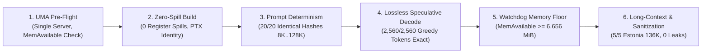

# Engineering Governance & Verification Gates

Because `sm_121a` (NVIDIA Grace Blackwell GB10) unifies 128 GB of LPDDR5X memory across CPU and GPU without a discrete PCIe VRAM boundary, any memory leak, unguarded allocation, or register spill directly degrades system stability or throughput. Speculative decoding and block-sparse attention optimizations are only useful when they preserve model reasoning accuracy and deterministic token output.

Every promoted release binary and operating recipe in `TheApathy/flux-engine` must pass six verification gates:

---

## 1. Gate 1: Zero Register Spills & Clean Target Compilation

1. **Clean Git Tree:** Release binaries are built from a clean Git checkout (`git status --porcelain` empty).
2. **Zero Register Spills (`ptxas` Verification):**
   - Every CUDA kernel compiled under `nvcc -arch=sm_121a --cubin -Xptxas -v -fmad=false` must report:
     `0 bytes stack frame, 0 bytes spill stores, 0 bytes spill loads`.
3. **Reference PTX Identity:**
   - Adding a new fused kernel path must not alter the compiled PTX of baseline reference entry points (`qwen4_qsa_prefill_attn_fp8_qk`, `qwen4_qsa_prefill_attn_fp8_qkpv`, `qwen4_qsa_prefill_plan_sort_desc`).

## 2. Gate 2: Multi-Repetition Numerical Determinism (`same_prompt_identity = PASS`)

1. **Kernel-Level `0-ULP` Verification:**
   - New or modified CUDA kernels (MoE `v28q`/`v17q`, mHC `upmix_roof_t128` / `combine_gemm`, QSA `ldmatrix.x4` score / `topk_v2` / `c3_v2`, GDN `conv1d_v3` / `ba_gates_mma`, PLE dequant) are verified against golden reference implementations before integration.
2. **End-to-End Prompt Repeatability:**
   - Repeated prefill + greedy decode executions across `8K`, `16K`, `32K`, `64K`, and `128K` context lengths (`4` reps per length = `20` requests) must produce bit-for-bit identical token sequences (`same_prompt_identity = PASS`).

## 3. Gate 3: `LOSSLESS 10/10` Speculative Decode Equivalence

Speculative decoding optimizations on `Qwen3.8-Flash-Next` (`K=5` Inferact MTP with 4 device-chained drafts) must be **strictly lossless**:
- Across all 10 greedy verification prompts (`256` tokens each = `2,560` generated tokens spanning `0`, `8K`, `32K`, and `64K` prompt depths), `K=5` speculative decode (`--speculative --num-drafts 4`) must match `--no-speculative` greedy decode **10/10 (`2,560 / 2,560` tokens bit-for-bit identical, `0 different`)**.

## 4. Gate 4: Unified Memory Floor & Watchdog Safety (`MemAvailable >= 6,656 MiB`)

Because the GB10 hardware watchdog resets the node if free unified memory drops to `6,144 MiB`:
- Serving benchmarks sample `/proc/meminfo` (`MemAvailable`) at 100 ms intervals across model load, warmup, 5-context prefill sweeps, and speculative decode.
- **Hard Requirement:** `MEASURED_FLOOR_MB >= 6,656 MiB` (`+512 MiB` safety margin above the `6,144 MiB` hardware watchdog) and `watchdog_kills = 0`.
- Persistent per-layer scratch buffers must reuse idle unified arenas (`ctx.buffers.ssm_deinterleaved()`) rather than allocating new resident memory.

## 5. Gate 5: 136.5K Long-Context Reasoning & E2E Test Suite

1. **136.5K Estonia 6-Hop Chain (`bench/qwen38-flash-next-gb10/estonia_bench.py`):**
   - Must achieve `5/5` (`100.0% PASS`) at `136,576` prompt tokens (`136,584` active KV tokens) past the planted `Latvia` decoy (`> 5,350 tok/s` prefill, `> 43 tok/s` decode, `MemAvailable >= 6,656 MiB`).
2. **CPU-Only Unit, Contract & Integration Suites:**
   - Workspace Rust tests (`ATLAS_SKIP_BUILD=1 cargo test --workspace --lib`), launcher/recipe contract tests (`pytest repro-kit/tests/`), and API compatibility tests (`tests/test_openai_compat_v2.py`, `tests/test_session_isolation.py`) must pass with zero regressions.

## 6. Gate 6: Zero-Credential, Zero-PII & Path Sanitization

1. Every file committed to `TheApathy/flux-engine` must pass `scripts/verify_no_leaks.py` with `0` violations.
2. All example filesystem paths use generic placeholders such as `/path/to/flux-engine` or `/models/...`.
3. Zero local usernames, machine hostnames, private IP addresses, or API tokens/keys are permitted in any tracked file.
